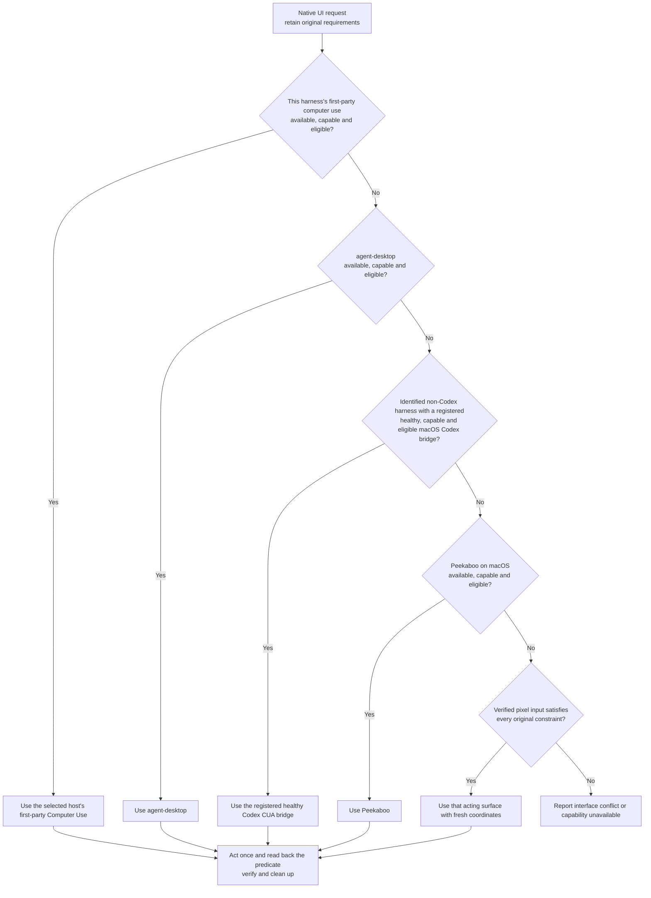

# Native UI Decision Tree

Read this reference when routing native apps, browser chrome or OS UI. Complete
the connector/API/service-CLI and page-DOM gates in the
[full decision tree](decision-tree.md) first. Identify the current harness before
selecting a native driver.

An eligible candidate must be available, authorized, supported on the platform,
compatible with an explicit interface choice, capable of the exact action and
all original input/state requirements, and able to read back the result. Apply
the same gate to every fallback. A policy or action denial is not a capability
gap that another tool may bypass.

## Shared selection policy

Every harness follows one order: its own first-party tool, agent-desktop, an
eligible registered healthy macOS Codex bridge, then Peekaboo. The current
harness determines the first-party tool identity and bridge eligibility; it
does not select a different tree. For Codex, the first-party tool is Codex
Computer Use and the bridge is always ineligible. An unknown harness cannot
use the bridge. Missing installation or registration does not authorize setup.
This is a selection preference among capable eligible tools, not a proven
performance ranking. Neither a microbenchmark nor a visible cursor preference
overrides the order.

## Execution and maintenance

Use [native UI routing](native-ui-routing.md) for discovery, cursor caveats,
session lifecycle and exact-target rules. A failed action needs observation
before retry or switching; rederive identifiers after a switch. A visible cursor
requirement needs actual renderer/visibility evidence, not just a saved setting.

The diagrams and executable candidate order use
[native-route-order.json](native-route-order.json). Change that source and run
`npm run routing:generate`; `npm run routing:check` rejects stale diagrams.
Research runs and PK observations live under the repository's
`docs/research/desktop-automation/`, outside the skill's execution content.
They inform changes but are not runtime inventory or required per-task reading.
